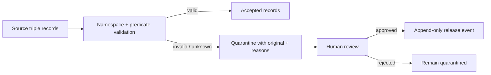

# Onto-Sieve

Validate and quarantine malformed, unsupported or insufficiently sourced triple records before they enter an ontology-grounded agent's memory or evidence store.

## Runnable MVP

This first implementation accepts a strict JSON array of triple records. It is **not yet an RDF/Turtle/OWL parser or SHACL engine**. It validates subject/object identifiers, allow-listed predicates, object types and datatypes, and source provenance.

Install with `python -m pip install -e .[dev]`.

Validate a file:

```bash
onto-sieve validate examples/triples.json --schema config/ontology.json --quarantine quarantine.json
```

Release a record only after an explicit human review:

```bash
onto-sieve release t-bad --quarantine quarantine.json --accepted accepted.jsonl --corrected-json corrected-triple.json --reviewer "reviewer-id" --note "Source checked and predicate corrected"
```

Quarantine preserves the original record and validation reasons. Release re-validates a corrected JSON record against the ontology contract, requires its ID to match the quarantined ID, appends the validated correction plus original record and reviewer note, and retains the quarantine history. An invalid correction cannot be released.

## Architecture



Run tests using `pytest -q`.

## Next

- RDF/Turtle and JSON-LD parsing through explicit adapters.
- SHACL validation with named shapes.
- Provenance signatures and reviewer identity integration.
- Versioned ontology migration and reversible quarantine release.

Do not treat a syntactically valid triple as a true statement. Source quality and truth require separate evaluation.


---

## Branch Activity & Development History

**Audit date:** 2026-11-18 · **Comparison base:** `main`

| Branch | Difference from `main` | Observed work / changed paths |
|---|---:|---|
| `feat/jsonl-triple-validation-mvp-20261116` | 21 ahead / 4 behind | JSONL triple validator, schema/triple examples, provenance/quarantine and RDF review skills, agent guidance and tests |
| `feat/triple-validation-quarantine` | 11 / 1 | Triple validation/quarantine implementation, ontology config, examples, CI/package config and tests |

### Open pull requests observed during this audit

- [PR #1 — triple validation MVP](https://github.com/Gitcoder12/Onto-Sieve/pull/1)

**Review note:** Compare the two overlapping validation branches before selecting one. Verify malformed JSONL handling, provenance preservation, quarantine behavior and tests on the exact PR head. No branches have been merged or deleted by this documentation update.
