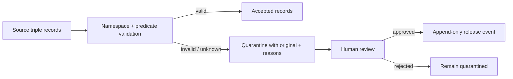

# Onto-Sieve

Validate and quarantine malformed, unsupported or insufficiently sourced triple records before they enter an ontology-grounded agent's memory or evidence store.

## Runnable MVP

This first implementation accepts a strict JSON array of triple records. It is **not yet an RDF/Turtle/OWL parser or SHACL engine**. It validates subject/object identifiers, allow-listed predicates, object types and datatypes, and source provenance.

Install with `python -m pip install -e .[dev]`.

Validate a file:

```bash
onto-sieve validate examples/triples.json --schema config/ontology.json --quarantine quarantine.json
```

Release a record only after an explicit human review:

```bash
onto-sieve release t-bad --quarantine quarantine.json --accepted accepted.jsonl --corrected-json corrected-triple.json --reviewer "reviewer-id" --note "Source checked and predicate corrected"
```

Quarantine preserves the original record and validation reasons. Release re-validates a corrected JSON record against the ontology contract, requires its ID to match the quarantined ID, appends the validated correction plus original record and reviewer note, and retains the quarantine history. An invalid correction cannot be released.

## Architecture



Run tests using `pytest -q`.

## Next

- RDF/Turtle and JSON-LD parsing through explicit adapters.
- SHACL validation with named shapes.
- Provenance signatures and reviewer identity integration.
- Versioned ontology migration and reversible quarantine release.

Do not treat a syntactically valid triple as a true statement. Source quality and truth require separate evaluation.

---

## Examples Used
- Validating a person-to-organization knowledge-graph triple
- Quarantining a record with an unsupported predicate
- Releasing a corrected triple after human source review


---

## Comparison with Existing Open-Source Projects

Onto-Sieve is documented as a validation and quarantine gate for structured ontology triple records, with human-reviewed release of corrected records. The current MVP accepts a strict JSON triple format; it is not yet an RDF/Turtle/OWL parser or SHACL engine. These projects provide relevant semantic-web validation foundations.

| Project | Established focus | Relationship to Onto-Sieve |
|---|---|---|
| [RDFLib](https://github.com/RDFLib/rdflib) | Python library for working with RDF graphs and linked data | A general RDF data model and parser foundation; Onto-Sieve currently validates a simpler JSON triple representation. |
| [pySHACL](https://github.com/RDFLib/pySHACL) | SHACL validation for RDF graphs | A formal shape-validation engine; Onto-Sieve's current allow-list/schema checks are narrower and should not claim SHACL compatibility. |
| [Apache Jena](https://github.com/apache/jena) | Java framework for RDF, SPARQL and semantic-web applications | A broad semantic-web stack; Onto-Sieve focuses on a small pre-ingestion quarantine and human-release workflow. |

### Where Onto-Sieve is different
- **Quarantine before ingestion:** malformed, unsupported or insufficiently sourced records are isolated with their original content and validation reasons.
- **Human-approved release:** corrected records are revalidated and released through an append-only event with reviewer note.
- **Provenance-aware validation:** source metadata is treated as part of the record contract, not an optional afterthought.

### Where established projects are stronger
RDFLib, pySHACL and Apache Jena have mature RDF parsing, graph processing and formal validation capabilities. Onto-Sieve currently supports a narrower JSON schema and does not yet parse RDF/Turtle/JSON-LD or execute SHACL shapes.

### Evidence and limitations
A structurally valid triple is not necessarily true. Keep source quality and truth assessment separate from syntax/schema validation. Test malformed identifiers, unsupported predicates, datatype mismatches, provenance gaps and release-history integrity. This is a workflow comparison, not a semantic correctness or ontology-reasoning benchmark.
